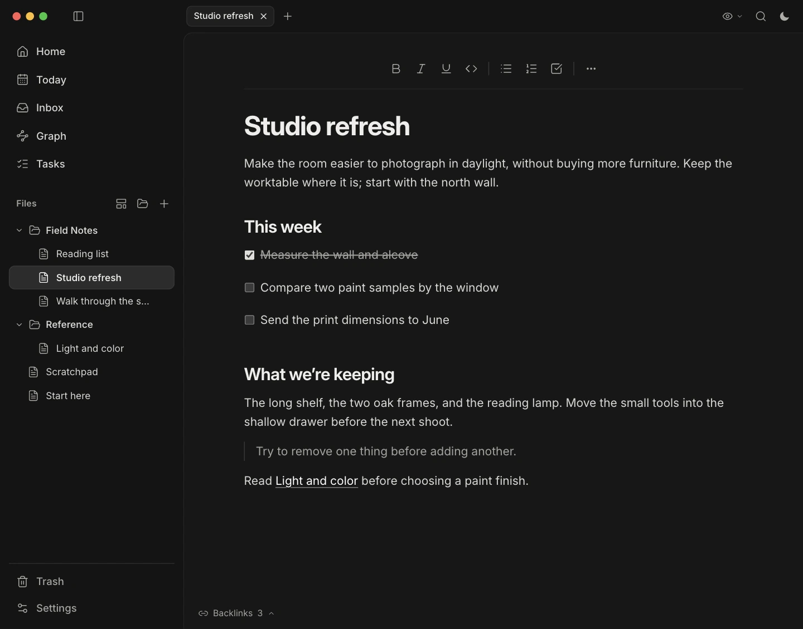

  
  <h1>rightmark</h1>
  
<strong>A quiet place to write. A folder you own.</strong>

  
Write, connect ideas, and keep track of what’s next in a local Markdown workspace for Mac.

  
  
  
Apple silicon · macOS 13 or later · No account required

## From a passing thought to work you can return to

**Catch it before it’s gone.** Press <kbd>⌃</kbd><kbd>⇧</kbd><kbd>N</kbd> from any app while rightmark is running. Sort the thought in Inbox later, or use Today to keep a daily record.

**Write without the syntax in your way.** Edit the formatted page, look at the Markdown, or put both side by side. Paste a screenshot, link a note with `[[`, and jump to a heading or the exact place another note mentions it.

**Keep the work with the notes.** A checkbox in a meeting note is the same checkbox you see in Tasks. Search across the folder with <kbd>⌘</kbd><kbd>K</kbd> and pick up where you left off when you reopen the app.

## Your notes are already files

Open a folder you already have. The notes stay as `.md` files, and screenshots live beside them in an `Attachments/` folder. You can open those files in another editor, back them up, or take the folder with you. Local drafts and version history help when a save is interrupted or a file changes elsewhere.

## Try rightmark

1. Download the [Apple silicon preview](https://github.com/yiaany/rightmark/releases/tag/v0.1.0).
2. Open the disk image and drag **rightmark** to **Applications**.
3. Try the sample workspace or choose **Open folder** to start with your own notes.

> This preview is not notarized. macOS may block it on first launch. Only try it if you’re comfortable testing a pre-release build, and use a copy of important notes.

[Workspace guide](docs/WORKSPACE.md) · [Design](DESIGN.md) · [Contributing](CONTRIBUTING.md) · [Releases](https://github.com/yiaany/rightmark/releases)
