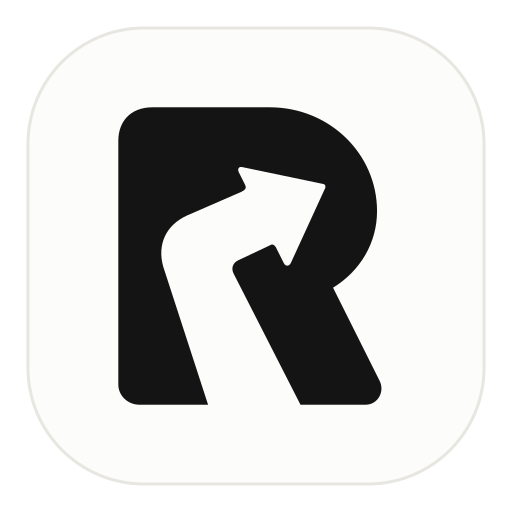

  
  <h1>rightmark</h1>
  
<strong>Taking notes shouldn’t be a second job.</strong>

  
Catch the thought. Write it down. Find it again. rightmark is a local Markdown workspace for Mac and Windows.

  

    
    
  

  

    
    
    
    
  

## Less Notion. More noting.

Notion is built for organizing a lot. rightmark is built for the moment you just need to write something down. No database to set up. No dashboard to maintain. You can organize the thought later. First, keep it.

### Catch it before it’s gone

Press <kbd>Ctrl</kbd> <kbd>Shift</kbd> <kbd>N</kbd> while rightmark is running. A small window opens over whatever you’re doing. Write one line, save it to Inbox, and get back to what you were doing.

### Write first. Connect things when it helps.

Write on the formatted page or edit the Markdown directly. Paste a screenshot. Type `[[` to link a note. A checkbox in a meeting note shows up in Tasks without asking you to enter it twice.

### Find it again without remembering where you filed it

Press <kbd>⌘K</kbd> on Mac or <kbd>Ctrl+K</kbd> on Windows to search inside your notes and jump straight to the match. Reopen the app and your tabs are still there. If a file changes in another editor, rightmark lets you compare and keep a copy instead of silently overwriting your work.

## Your notes are already yours

Open a folder you already have. Notes stay in ordinary `.md` files; screenshots stay in the workspace’s `Attachments/` folder. Back up the folder, open it in another editor, or take it with you. There’s no account to log into and no export step to get your notes back.

## Pick your installer

Both installers are on the same [v0.1.1 release page](https://github.com/yiaany/rightmark/releases/tag/v0.1.1), with SHA‑256 checksums.

| Platform | Install |
| --- | --- |
| **macOS 13+ · Apple silicon** | Open the `.dmg` and drag **rightmark** to Applications. |
| **Windows 11 · x64** | Run `rightmark_0.1.1_x64-setup.exe`. If Edge WebView2 is missing, setup may need an internet connection. |

These are public preview builds. The Mac app is not Developer ID–signed or notarized, and the Windows installer is unsigned. Gatekeeper or SmartScreen may warn. Intel Mac and Windows ARM64 installers are not included.

**Start with the sample workspace, or open a folder of your own.**

[Workspace guide](docs/WORKSPACE.md) · [Design](DESIGN.md) · [Contributing](CONTRIBUTING.md) · [Releases](https://github.com/yiaany/rightmark/releases)
